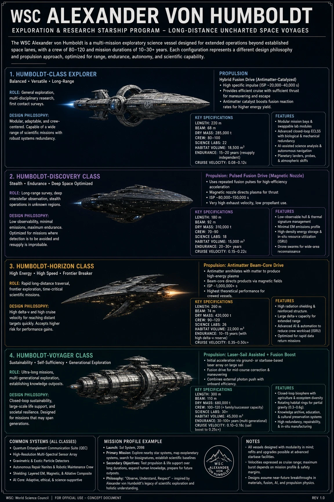
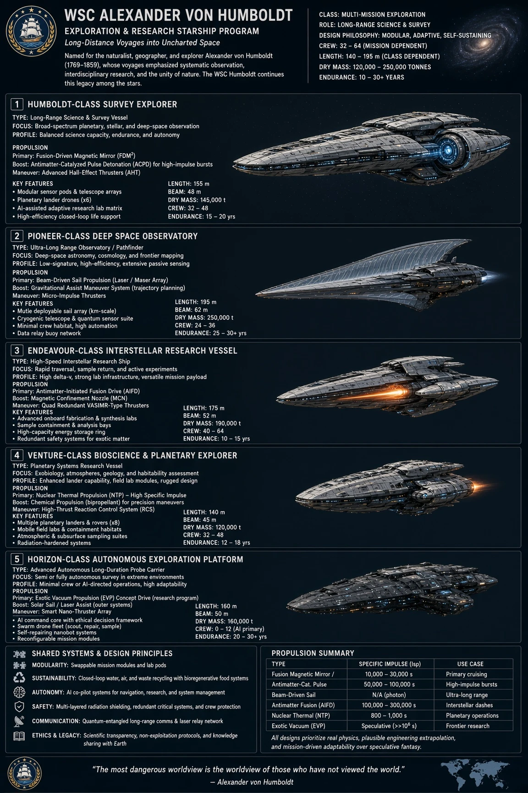
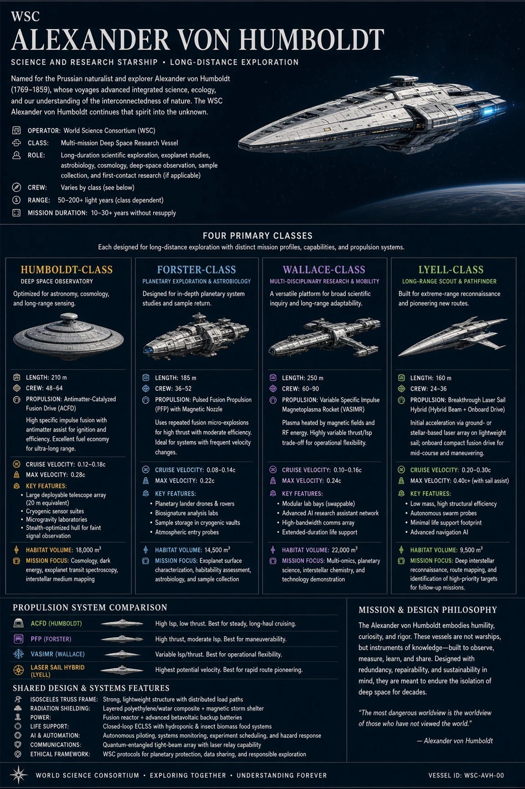
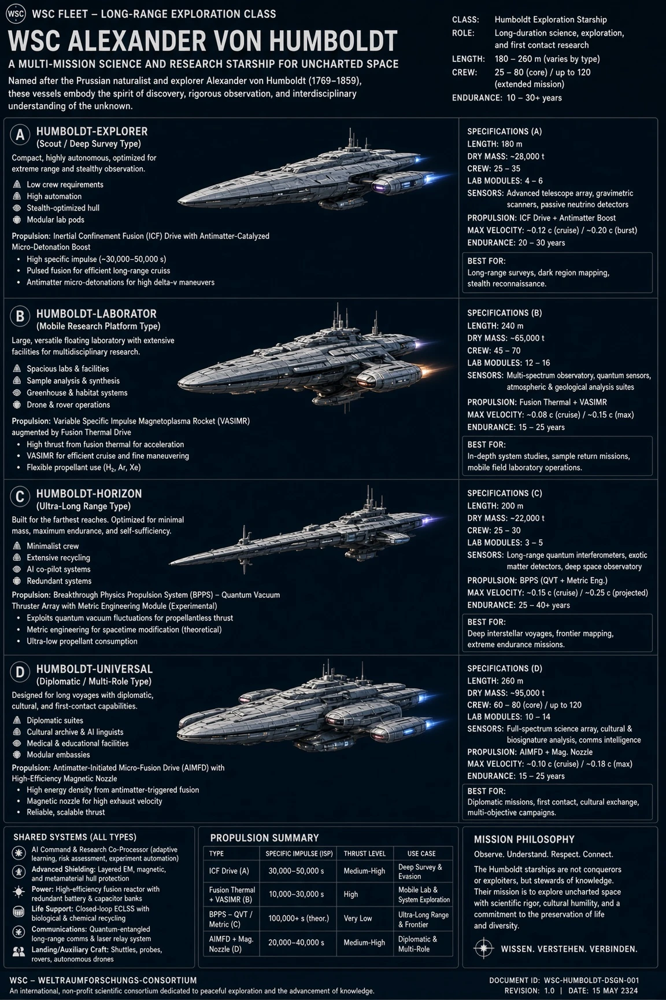
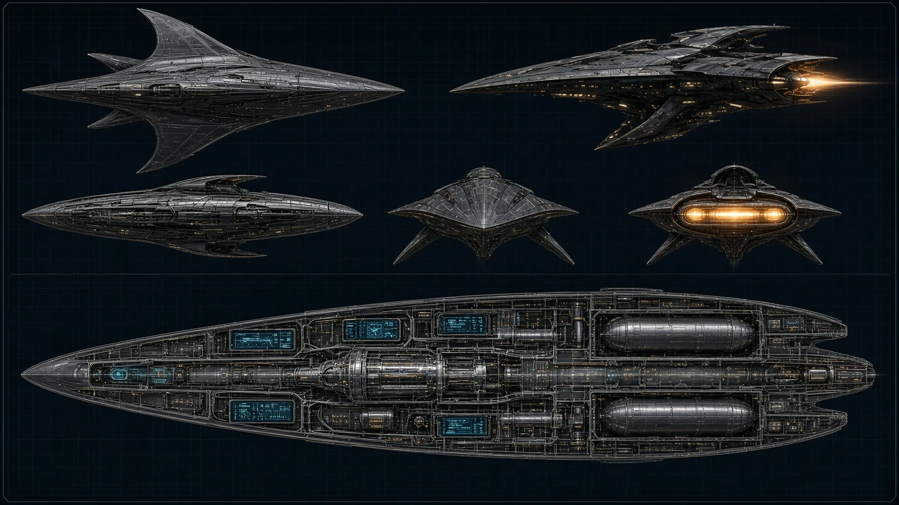

# Propulsion: From Rockets to Theory
*A catalogue of real and theoretical spacecraft drives* (reference book, no test; DRAFT for Eric)

**Thrust, exhaust speed and specific impulse.** Every drive works the same basic way: it throws some mass out the back, and the craft moves the other way. The push this gives is called thrust, and it depends on how much mass leaves each second and how fast it leaves. Exhaust speed is the key number for efficiency. Specific impulse, written Isp, is the exhaust speed divided by the standard pull of gravity at Earth's surface, and it is measured in seconds. A higher Isp means more change in speed from each kilogram of propellant, so a high-Isp drive can go far on less fuel, although it usually pushes more gently.

**Chemical rockets.** A chemical rocket burns fuel and oxidiser together, and the hot gas leaves through a nozzle. Liquid engines burning hydrogen with oxygen reach the top of the range, while solid motors are simpler and easy to store. Typical Isp is about 250 to 470 seconds, with the highest values for hydrogen engines in vacuum. Thrust is high, so these drives lift off planets and change speed quickly. They are best for launches and for any job that needs a large push at once. Status: PROVEN, flown for decades.

**Nuclear thermal rockets.** A nuclear thermal rocket passes a propellant, usually hydrogen, through a hot nuclear reactor, and the gas leaves through a nozzle. Hydrogen is light, so the exhaust is much faster than chemical exhaust. Typical Isp is about 800 to 1,000 seconds. Thrust is high, similar to a chemical engine, which makes these drives useful for fast trips between planets. Status: TESTED. Ground engines in the NERVA programme ran in the 1960s and 1970s, but no nuclear thermal engine has flown in space.

**Hall-effect thrusters.** A Hall-effect thruster uses electric power to ionise a gas, usually xenon, and a magnetic field traps electrons in a ring. An electric field then pushes the ions out at high speed. Typical Isp is about 1,500 to 3,000 seconds. Thrust is gentle, measured in tens to a few hundred millinewtons, so the craft speeds up slowly over weeks or months. It is best for station keeping and long cruises. Status: PROVEN, flown on many satellites.

**VASIMR, a variable plasma rocket.** VASIMR heats a gas into plasma, a hot mix of charged particles, using radio waves, and a magnetic nozzle turns the plasma into thrust. Its special feature is that the balance between push and efficiency can be changed while it runs. Its Isp can be set across a very wide range, roughly 3,000 to 30,000 seconds, and thrust falls as efficiency rises. Thrust is low to moderate and depends on the power supplied. It is best for long trips that need a steady push. Status: TESTED on the ground at high power, but no flight engine has flown.

**Solar sails.** A solar sail is a very large, thin reflective sheet. Sunlight pushes on it because light carries momentum, although the push is tiny. A sail uses no propellant at all, so Isp does not apply in the usual way. Thrust is very low, and it builds up over months into steady gains in speed. Solar sails suit long voyages and slow changes between orbits. Status: PROVEN. JAXA's IKAROS spacecraft unfolded a sail and used sunlight to steer in 2010.

**Beam-driven laser sails.** A laser sail is a very thin sail pushed by a powerful laser beam from the ground or from orbit, not by sunlight. A far stronger beam could push a sail to speeds well above what a chemical rocket can reach. The Breakthrough Starshot concept studied sails of about a gram, pushed by a ground laser array of about 100 gigawatts. Thrust is very small but is applied very hard for a short time. It is best suited to sending very light probes toward nearby stars. Status: THEORETICAL. The physics works and studies exist, but no sail of this kind has been built or flown.

**Magnetic-mirror fusion drives.** A magnetic-mirror drive would hold a hot fusion plasma in a long magnetic bottle whose ends reflect particles back inward. Fusion inside the plasma would release energy, and a magnetic nozzle would direct the exhaust out as thrust. Mirror machines have been built and tested as fusion experiments, but none has produced the net energy a drive would need. The exhaust speed could in principle be high, but no reliable figure exists yet, so none is given here. Status: THEORETICAL.

**Inertial-confinement fusion drives.** Inertial-confinement fusion squeezes a tiny fuel pellet with powerful lasers or ion beams so that it fuses in a fraction of a second. A drive would fire a stream of pellets one after another, and each burst would push the craft through a magnetic or plasma nozzle. The National Ignition Facility reached ignition in December 2022, when fusion released more energy than the laser energy that reached the target, but that was a research result and not a power source. Thrust would come in pulses, and no reliable Isp figure exists yet. Status: THEORETICAL. Part of the physics is shown in the laboratory, and no drive has been built.

**Pulsed fusion with a magnetic nozzle.** This concept fires a pulse of plasma that burns inside a magnetic field, and a magnetic nozzle turns the expanding plasma into thrust. Because each pulse is separate, the thrust arrives in bursts rather than as a steady flow. The aim is a high exhaust speed and good efficiency, but the real numbers depend on engineering details that have not been worked out. The idea would be useful for fast trips only if the fusion itself can be made practical. Status: THEORETICAL. Parts are studied in laboratories, and no complete drive has been built.

**Antimatter-catalysed fusion.** In this concept, a small amount of antimatter starts a fusion reaction in a larger amount of fuel. When matter meets antimatter, the two annihilate and release energy, which helps trigger the fusion. The idea could give a great deal of energy from very little mass. Antimatter, however, is made only in tiny quantities, in particle accelerators, at very high cost; far less than a gram has ever been produced. Status: THEORETICAL. The reactions are known, but making, holding and handling enough antimatter is far beyond current capability.

**Antimatter beam-core drives.** An antimatter beam-core drive would let antimatter annihilate and send the energetic particles and light that result out through a magnetic nozzle. Because the exhaust comes straight from annihilation, its speed could in principle be a large fraction of the speed of light. That would give an Isp in the millions of seconds, the highest value of any concept in this book. Thrust would depend on how much antimatter can be fed in and controlled. Status: THEORETICAL. The physics of annihilation is well known, but no such engine has been built, and the antimatter supply is the same hard limit as before.

**Gravitational assists.** A gravity assist, or slingshot, uses a planet's pull to change a spacecraft's path and speed without burning propellant. The craft flies close to a planet and swings around it, gaining speed by drawing a very small amount of energy from the planet's orbit. Voyager and Cassini both used planetary flybys to reach their far destinations. No engine produces this thrust, so Isp does not apply. It is best for reaching distant targets cheaply, and it works alongside any other drive. Status: PROVEN, used on many missions.

**Quantum-vacuum thrusters (speculative).** Some proposals claim that a drive could push against the quantum vacuum, the energy that fills empty space, without throwing any mass out. Devices such as the EmDrive reported small forces in tests, but those results have not been reproduced under controlled conditions that rule out other causes. No accepted mechanism explains such a force, and most physicists expect that momentum cannot be created from nothing, so claims of this kind must be checked very carefully. Status: SPECULATIVE. There is no accepted evidence that such a drive works, and this book gives no figures for one.

**Metric engineering and warp drives (speculative).** Metric engineering is the idea of reshaping space itself, so that a ship could cover great distances faster than light could cross them, without moving through space at that speed. The best-known example is the Alcubierre warp bubble, a mathematical solution of Einstein's equations. Such solutions appear to require exotic matter with negative energy, which has never been produced in the amounts needed, and their physical workability is still debated. Status: SPECULATIVE. It lies beyond known physics, and no evidence shows that it can be done.

**Why every drive is a trade-off.** Every drive balances thrust, efficiency, mass and safety, and no drive wins on all four. A high-thrust engine, such as chemical or nuclear thermal, can lift off a world or change course quickly, but it spends propellant fast. A high-efficiency drive, such as a Hall-effect thruster or VASIMR, uses little propellant but pushes so gently that a journey can take months or years. Mass matters too, because a heavier drive and its power source need more energy to move. Safety sets the last limit, since reactors, high voltages and antimatter each bring hazards that must be managed.

## Illustrations

*Early design studies: four research-ship concepts and their drives* (not the Starship as built)

*Early design studies: five mission types, with a propulsion summary* (not the Starship as built)

*Early design studies: four classes compared by drive* (not the Starship as built)

*Early design studies: four types, from scout to diplomatic ship* (not the Starship as built)

*A design study in plan, profile and cutaway: tanks, reactor and drive line* (not the Starship as built)

