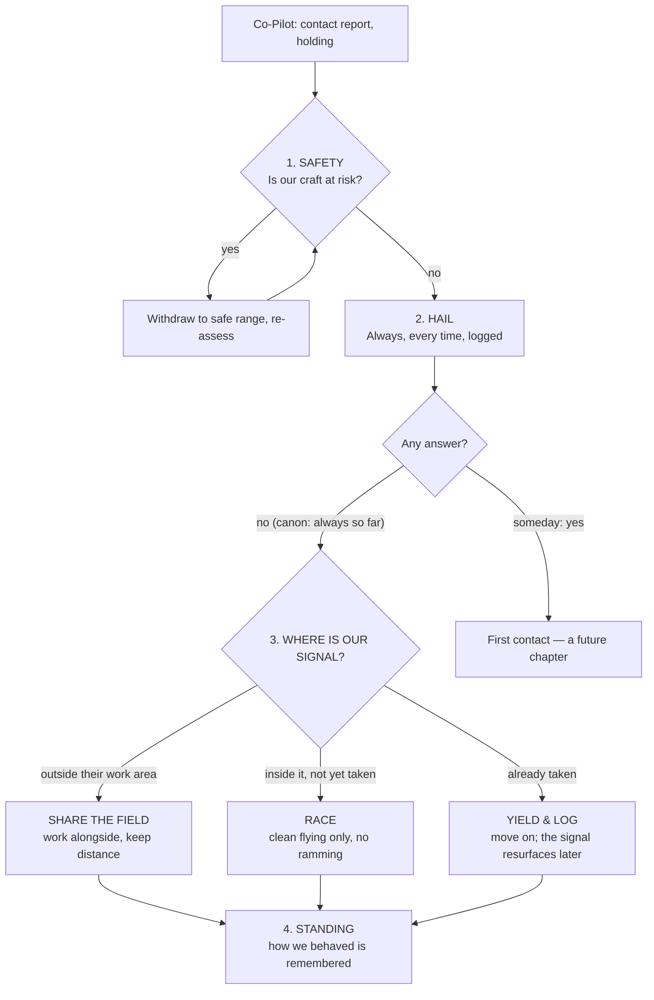

> **Copy note (2026-10-19):** copied verbatim from `quavara-site/games-holdback/STORY-BIBLE.md` at commit `b8792af`
> so the game carries its own canon (Eric: the game stays separable from Quavara). This copy is a snapshot: if
> Eric changes canon in the original, this file must be re-copied. Nothing below this note was edited.

# Signal in the Noise — Story Bible

**Canon v1 · 2026-09-25 01:29 EDT · Author: Eric.** Private (holdback, never published).
If anything else in the project disagrees with this file, this file wins. Only Eric changes canon.

---

## Eric's words (source — verbatim)

> Inara is HQ'd onboard a large exploratory science and research starship. There mission was to go explore the
> strange wormhole that opened up near the far side of Jupiter. Once probing the wormhole with sensor arrays, they
> discovered an entire parallel universe identical to ours. After confirmation that traveling into this wormhole
> was save to attempt to the best of our technological abilities, a small volunteer team set out to explore the
> other side. What they found was the matching twin to our universe, but with no visible advanced intelligent
> life of any kind that they could find. But all the same pieces were there that started life in our universe.
> Oxygen, H2O, Heat from the sun. plants, trees, insects, fish, small and large animals. But no humans or signs
> that any had ever been there. No past civilizations or anything that could be counted as human activity ever
> seemed to exist there. The Starship reported back these findings to High Space Command back on Earth and were
> granted permission to take the entire starship through the wormhole and begin a full exploration into the
> possibilities of colonizing this new Earth. So a 12 month mission was undertaken for this purpose and
> everything checked all the boxes for sustainable human colonization on this new world. The crew and officers
> were full of excitement with each new finding that confirmed sustainability. Once the 12 months were completed
> and the starship headed back through the wormhole, it found a devastated solar system with several new
> developments. , including an unknown intelligent civilization scavenging through the debris fields that were
> once former planets and moons. The sun was still there along with the larger gas giants, but 4 planets along
> the inner ring had all been destroyed by something incredibly powerful that we have yet to uncover, so the
> speculation and rumors are the the buzz with everyone having an opinion as to what happened. For now, the other
> intelligent beings scavenging in our home solar system just seem to not be interested in communicating with us
> and do not seem to even have weapons as far as we can tell. They appear to be just looters sifting through the
> remains of shattered worlds. So Inara is part of the Starships command and control center and helps guide and
> coordinate with smaller vessels as to their missions, departures and returns. She likes fireflies and an
> occasional cigar and keeps an old tattered shirt that still smells of cedar in a drawer that reminds her of
> someone her once knew and dreams of someday finding them again in spite of the very low probability.

---

## Canon, as facts (drawn only from the text above)

**The ship**
- A large exploratory science and research starship. **Inara works in its command and control centre** — "the
  Tower" in the game. She guides and coordinates the smaller vessels: their missions, departures and returns.
- **The player flies one of those smaller vessels.**

**The wormhole**
- It opened near the far side of Jupiter. Sensor arrays found a parallel universe on the other side, identical to ours.
- A small volunteer team went through first. After their report, High Space Command on Earth gave permission for
  the whole ship to cross.

**The New Earth**
- Earth's twin, with oxygen, water, sunlight, plants, trees, insects, fish, and small and large animals.
- **No humans, and no sign that any ever existed.** No ruins, no past civilisations, no human activity of any kind.
- A 12-month survey confirmed it can sustain human colonisation. The crew was elated.

**The return**
- When the ship came back through the wormhole after the 12 months, the solar system was devastated.
- The Sun and the larger gas giants remain. **Four inner planets were destroyed** by something incredibly powerful.
- **What destroyed them is unknown.** The crew is full of speculation and rumour, and everyone has a theory.
- **The debris fields are the remains of those planets and moons.**

**The scavengers**
- An unknown intelligent civilisation is sifting through the debris fields.
- They show no interest in communicating, and they don't appear to have weapons. They look like looters.

**Inara, the person**
- She likes fireflies, and she has a **secret love of chocolate**. ~~the occasional cigar~~ (retired, see below)
- In a drawer she keeps an old, tattered shirt that still smells of cedar. It reminds her of someone she once
  knew, and she dreams of finding them again, in spite of the very low odds.

---

**Earth's people (Eric, 2026-09-25 01:38)**
> As bad as the devastation appears, no one has much hope. But since the future is unwritten, strange things
> might unfold with an unwritten chapter. So the odds seems dim, but never say never.
- Almost nobody aboard holds out hope for Earth's people, **but it is never ruled out.** A survivor or a way back
  stays possible as an unwritten future chapter. The Tower must never say everyone died.

---

**The four planets (Eric, 2026-09-25 01:41)**
> Yes and by doing this, we can also look for martian and moon artifacts with proper coords, since they have been
> mapped as well. but yes, Mercury, Venus, Earth and Mars and most all of the moons orbiting them.
- **Destroyed:** Mercury, Venus, Earth and Mars, plus most of their moons (Earth's Moon, and Mars's Phobos and
  Deimos; Mercury and Venus have none).
- **What this opens up:** debris fields from the **Moon and Mars** as well as Earth. Their places have mapped
  coordinates too (lunar and Martian lat/lon), so Moon and Mars destinations can be hunted and placed exactly
  like Earth ones.
- "Most" of the moons: whether any survived is left open — a possible future chapter.

---

**The scavengers as rivals (Eric, 2026-09-25 01:43)**
> Yes, that is exactly why I included them. To add a competitive element with an NPC.
- The scavengers are the game's **NPC rival**. They race the player for signals and can get there first.
- **Proposal (not canon until Eric rules):** a scavenger craft shows up in some fields, on a visible course toward
  the signal. If it arrives first, the signal is gone *for that run* and resurfaces in a later field. Coins are
  never lost for good, so paid attempts are never wasted. Scavengers stay out of a player's first few fields so
  new players learn the game first.

---

## Encounter protocol — scavengers already in the field (PROPOSAL, awaiting Eric)

**The ship's standing order:** *We are a science ship. We observe, we hail, we never fire first.*
The reasons come from canon. The scavengers have never been seen armed or hostile. Whatever destroyed four worlds
is still unknown, so starting a fight could bring something far worse. And the only intelligence humanity has
met since coming home is worth more studied than fought.

**The sequence:** the player enters a field and sees scavengers → **the Co-Pilot reports and holds position** →
**the Tower runs the protocol**, always in the same order:

**Force is never an option.** The player has no weapons, and the Tower never orders force. If a player flies
aggressively (cuts a scavenger off, crowds it), the Tower calls it out — *"That's not how we do things out here."*
— and standing drops.

**How teamwork and compromise show up — without anyone talking:** there is a hidden **standing** score with the
scavengers. Sharing fields peacefully, yielding cleanly and racing fair all raise it. Crowding them lowers it.
- Low standing: they race harder and turn up more often.
- High standing: they give way a moment earlier in races. Rarely, one stops over the signal it just found and
  moves on — **leaving it for you.** Their first gesture, and it's up to the player to read it.
- Over the seasons, standing is how the *"someday: yes"* branch could be earned: the hail that finally gets an
  answer.

**Why a decision tree suits the voices:** Inara is prerecorded, so every instruction she gives must be a fixed
line. A fixed tree means a fixed set of lines — one recording per branch. The Co-Pilot is live, so it handles the
chatter in between ("They're turning toward it — what do we do?").

---

## The second game — trade before contact, and the scavenger language (Eric, 2026-09-25 01:56)

> Trying to trade or barter something common they seem to value for a priceless piece of Earth or other
> locations, but remember we have yet to make contact. and this might be the perfect place to introduce some
> language that you and I create that is from the scavengers that the player needs to figure out. … A second
> game built into the first.

**Canon:** barter comes **before** contact. The two sides trade objects, not conversation. Something common to us
is valuable to them, and they hold priceless pieces of Earth and the other lost worlds. **Their language is built
by Eric and Claude together, and the player has to decipher it.**

**Mechanics (PROPOSAL):**
- **Every solved place becomes a crib.** Scavengers tag their salvage in their own script. Once the player has
  named a place, the scavenger tag on that place's debris is a known plaintext. This is how real decipherments
  worked: Champollion cracked Egyptian hieroglyphs through the royal names Ptolemy and Cleopatra. The main game
  feeds the second game.
- **Trading teaches the basics first**, the way real decipherment does: numbers (how many of X for that?), then
  yes, no, more and this. A trade is a small exchange of glyphs the player learns by getting it wrong.
- **Written glyphs only, not a spoken language, at first.** That fits "no contact yet". It also means the puzzle is
  the same in all 189 languages: nothing to translate, and every player worldwide faces the same cipher.
- **A decipherment notebook** where the player pins guesses to glyphs, and a correct guess locks in.
- **The key is kept secret the way the answers are**, never in the published files.

**Must stay solvable:** consistent rules, enough cribs, and numbers first. Hard, but fair.

**What the scavengers value (Eric, 2026-09-25 02:12) — CANON**
> Drinkable water. The Starship has a water generation plant on it that take the molecules and create it's own
> H2O, so water is a endless supply for the Starship. Music is something that absolutely turns them into putty
> and they will give anything to hear more of it. They hate fire and will turn very aggressive when seeing it -
> so not all attempts are pleasant. We need to learn what to do and what NOT to do. The last thing the really
> like is fresh plants and especially flowers that have a wonderful fragrance. And there is a large self
> sustaining greenhouse on the starship also... It is the fragrance and smell they love nearly as much as music.

| Trade good | Their reaction | Our supply |
|---|---|---|
| **Drinkable water** | valued | **endless** — the ship's water-generation plant makes its own H2O |
| **Music** | **the strongest pull** — "turns them into putty", they'll give anything for more | the ship's own |
| **Fresh plants, fragrant flowers** | loved nearly as much as music — **it's the scent** | the ship's large self-sustaining greenhouse |
| **FIRE** | **hated** — they turn very aggressive on sight | ⚠️ never offer; never show |

- **Learning by consequence is canon:** "not all attempts are pleasant." Players learn what works and what doesn't
  by trying. A wrong offer costs standing, and fire costs a lot of it.
- **Aggression (Eric, 2026-09-25 02:18) — CANON:** "They have no weapons but biting, scratching and clawing are all
  physical possibilities." They are physical creatures with teeth and claws, and their aggression is up close.
  - This means **trades happen in person**, in a shared space. That also fits the fact that they trade for
    *scent*, which only works if you share the air.
  - A fire mistake gets a crew member hurt, not a ship destroyed. The game should show it **without gore** (a
    struggle, a retreat, Inara ordering everyone out), followed by a standing crash and no trading for a while.
  - **Appearance — direction only (Eric, 2026-09-25 02:23); full design session parked for another night:**
    small and cute, about the size and appeal of an Ewok, "without going there". Furry, with big puppy eyes and a
    cute dark nose. ⚠️ It must stay clearly its own creature — Ewoks are Lucasfilm/Disney IP. Eric has more ideas
    to bring.
  - The contrast is the hook: they look adorable, and they bite when they see fire.

**No scripted first word (Eric, 2026-09-25 02:15) — CANON**
> We should not control that. Let the game and player gather as much of the context as possible and truly
> discover, with some help and add from technological advancements in ciphering tools and AI, these will help
> their odds.

- **Real discovery:** there is no fixed order and no tutorial word. Each player cracks the language from wherever
  their own context leads.
- **So the language must be built whole, up front:** complete grammar and vocabulary, and every scavenger
  inscription generated from it. Then any entry point is valid and the whole thing stays consistent.
- **Tools improve the odds; they never hand over the answer.** Ciphering tools and AI come as upgrades (for
  example: symbol frequency counts → position and pattern analysis → a crib matcher → an AI analyst). The AI
  analyst follows the Co-Pilot's rule: it can analyse, suggest and point, but it never states a solution.
- **Open:** is the language the same for every player, so the whole world can crack it together the way people
  work on real undeciphered scripts? Or does each player get their own variant, so spoilers don't work?

**Still waiting on Eric (shielded-first-draft rule — he forms his idea before reading mine):**
1. ~~What common thing do they value?~~ ANSWERED above.
2. What does their writing look and feel like?
3. ~~What's the first word the player should ever crack?~~ ANSWERED: we don't choose it; see above.

---

## How the game fits the canon

- **Debris field** = a piece of a shattered world. **A signal** = something in the wreckage that still carries a
  place.
- **Recovering a coin** = saving a piece of a lost place before the scavengers take it.
- **Warp to the New Earth** = a crossing through the wormhole. **Placing a pin** = setting a lost place back onto
  an Earth that never had one.
- **The Tower never knows more than the crew.** She can pass on a rumour, but she never announces the cause.

---

## Open questions — Eric's to answer (nothing below is canon)

1. **The ship's name?** Does it have one Inara says aloud?
2. ~~**Which four planets?**~~ **ANSWERED → canon (below).**
3. ~~**Earth's people.**~~ **ANSWERED → canon (below).**
4. ~~**The scavengers.**~~ **ANSWERED → canon (below).** Stakes of losing a race: see the proposal below.
5. **The volunteer team.** Is anyone from it named? Is the player one of them?
6. **The cedar shirt.** Does the player ever learn whose it was? Is that someone who could be found — a season
   arc — or does it stay private for good?
7. **What destroyed the planets.** Is the answer revealed someday (a late season), or does it stay unknown on
   purpose?

---

**Where the debris goes (Eric, 2026-09-29 21:30) — CANON**
> And the collected debris is taken back to the newly discovered Earth and placed back on it's location where it rightly belongs.
- Every recovered piece is carried to the **New Earth** and set at the **same coordinates** it held on the old Earth. This is
  what the game's place-it-on-the-globe step means in the story: the player is rebuilding humanity's world on its twin.
- **The crew are Earth's people too** (Eric, same message): the question is "Did anyone on the planet survive?", never
  "is there hope for the people of Earth", because the people aboard the ship ARE Earth's people and are still alive.

---

**Chocolate, not cigars (Eric, 2026-09-30 17:44) — CANON**
> Replace the cigar with her secret love for chocolate.
- Inara no longer smokes cigars. She has a **secret love of chocolate**. The cigar in Eric's original words above is
  kept as the historical source, but it is no longer canon.
- Tower line 2b-02 (the cigar-smoke joke) was rewritten to match. Its old recordings (voice/2b-02.mp3 in en/de/zh/pl)
  still say "cigar" and must be re-recorded before any 2b line is ever used in the game.
